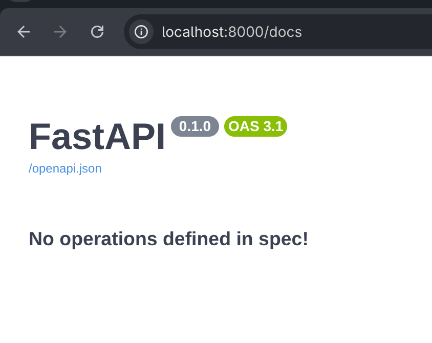

# crear un entorno virtual
python -m venv venv
source venv/bin/activate

# librerías necesarias

`fastapi`
`pydantic-settings`
`uvicorn`
`sqlalchemy`
`alembic`
`psycopg2-binary`

# pip freeze > requirements.txt

# configurar alembic el ORM

`alembic init alembic`

# si ves esto todo bien !
